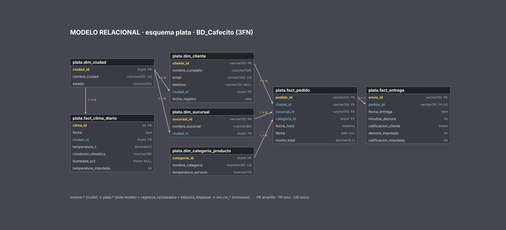

# Cafecito · Proyecto Integrador
### Integración de Datos en SQL Server

**Materia:** Integración de Datos | Universidad Iberoamericana León
**Equipo:** 1 (Grupo O3) | **Tablero Trello:** [Proyecto Integrador · Equipo 01](https://trello.com/invite/b/6aa97d88102a03bae3a759d9/ATTIac21e3544634e35a84ad29c4d6a9c64d1C37751F/proyecto-integrador-equipo-01)

## 1. Descripción del Proyecto
Cafecito es una cafetería con sucursales en León, Silao y Guanajuato que vende por e-commerce con entrega a domicilio. Se integran **tres fuentes heterogéneas**: pedidos y clientes del sistema transaccional (`BD_Ventas_Cafecito`), el clima diario de una **API en JSON** y las entregas a domicilio en un **CSV**. Con una arquitectura Medallón en **Microsoft SQL Server** se responde la pregunta de negocio: *¿cómo afecta el clima a lo que piden los clientes y a su satisfacción con la entrega?*

## 2. Arquitectura de Integración (SQL Server)

* **Esquema `bronce` (Ingesta):** 5 tablas espejo con la carga cruda de las fuentes; todo en texto, sin alterar tipos ni limpiar.
* **Esquema `plata` (Transformación y QA):** modelo relacional en 3FN (`dim_*`, `fact_*`). El procedimiento `plata.sp_limpiar_y_cargar_plata` estandariza textos (`TRIM`/`UPPER`), convierte fechas con `TRY_CONVERT`, elimina duplicados con `ROW_NUMBER()`, imputa faltantes (`COALESCE`/`ISNULL`, mediana, moda, promedio) y manda a cuarentena lo inválido (`plata.registros_rechazados`). Es **idempotente**: se puede ejecutar varias veces sin duplicar.
* **Esquema `oro` (Consumo y BI):** `oro.vw_analitica_360_cliente` (Vista 360°) y KPIs: `vw_kpi_consumo_por_clima`, `vw_kpi_logistica_por_clima`, `vw_kpi_resumen_sucursal` y `vw_ventas_operativa`.

**Resultado clave:** con *lluvia intensa* la demora promedio sube a **51.04 min** y la calificación baja a **2.26**, frente a **4.29** con clima templado.

| Entidad | Bronce (crudo) | Plata (válido) |
|---|---|---|
| Clientes | 42 | 41 (40 + `CLI-000` genérico) |
| Pedidos | 135 | 129 |
| Clima | 65 | 63 |
| Entregas | 107 | 103 (1 huérfana a cuarentena) |

## 3. Modelo Entidad-Relación (DER)

## 4. Estructura del Repositorio (`/src`)
* `01_ddl_arquitectura_der.sql`: creación de la base de datos, los esquemas `bronce`/`plata`/`oro`, tablas, llaves y catálogos.
* `02_etl_ingesta_bronce.sql`: carga cruda (`INSERT`, `OPENJSON`; `BULK INSERT` y `OPENROWSET` como opción B comentada). Idempotente con `TRUNCATE`.
* `03_etl_limpieza_plata.sql`: diagnóstico de anomalías, `sp_limpiar_y_cargar_plata`, `sp_registrar_cliente` y pruebas de calidad de plata.
* `04_vistas_gold_bi.sql`: vistas oro (360° y KPIs), diccionario de datos con propiedades extendidas y pruebas de oro.

**Orden de ejecución:** `01 → 02 → 03 → 04`. El `01` elimina y recrea `BD_Cafecito`; `02` y `03` se pueden repetir sin duplicar.

## 5. Integrantes y Roles (4 Roles Oficiales)
* **Data Architect / SQL Specialist:** André Campos Díaz
* **Data Engineer / Pipeline Lead:** Ana Sofía Arroniz Domínguez
* **Data Quality & QA Specialist:** Paulina Karime Martínez Rivera
* **Líder de Proyecto & BI Specialist:** Juan José Gómez Montúfar (Líder de Proyecto) y Antonio Hernández Ontiveros (BI & Analytics Specialist)
