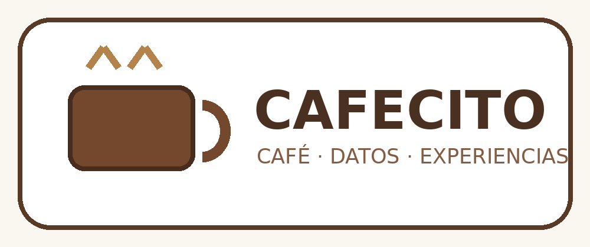
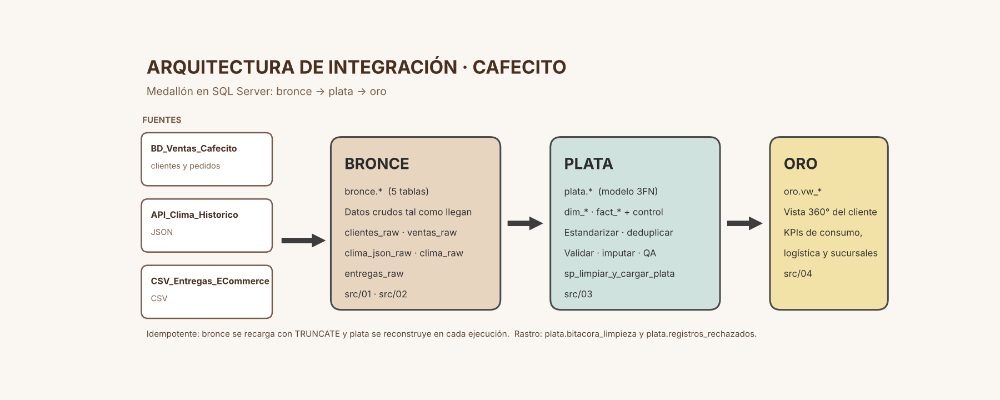

# Cafecito — Proyecto Integrador
### Integración de Datos en Microsoft SQL Server

**Materia:** Integración de Datos | Universidad Iberoamericana León  
**Equipo:** 1 | **Grupo:** O3  
**Tablero Trello:** https://trello.com/invite/b/6aa97d88102a03bae3a759d9/ATTIac21e3544634e35a84ad29c4d6a9c64d1C37751F/proyecto-integrador-equipo-01

## 1. Descripción del proyecto
Cafecito es un caso de negocio de cafetería con ventas por sucursal y entregas a domicilio. El proyecto integra tres fuentes: la base relacional de ventas/clientes del e-commerce, un archivo JSON con clima histórico por ciudad y fecha, y un CSV de entregas con demora y calificación. El objetivo es analizar si las condiciones climáticas influyen en la mezcla de productos solicitados, el desempeño logístico y la satisfacción del cliente.

## 2. Arquitectura de integración

- **Bronce:** los datos originales se conservan en tablas de staging del esquema `stg` (`Clientes_Raw`, `Ventas_Raw`, `Clima_Raw`, `Clima_JSON_Raw`, `Entregas_Raw`).
- **Plata:** los datos limpios, estandarizados, deduplicados y validados se guardan en el modelo relacional/dimensional. En la versión original del proyecto están en `dbo` (`dim_*` y `fact_*`).
- **Oro:** las vistas analíticas para operación, Vista 360° y KPIs se exponen mediante vistas de consumo.
- Para alinearse con la nomenclatura solicitada en la guía, `src/05_capas_medallon_compatibilidad.sql` crea los esquemas `bronce`, `plata` y `oro` como **vistas de compatibilidad** sobre los objetos existentes. No duplica físicamente los datos.

## 3. Modelo Entidad-Relación

El modelo contiene dimensiones de Ciudad, Sucursal, Categoría y Cliente; hechos de Pedido, Entrega y Clima diario. Las llaves foráneas mantienen la integridad referencial. Pedido–Entrega es 1 a 0..1; Cliente–Pedido es 1 a N; Ciudad se relaciona con sucursales, clientes y clima.

## 4. Fuentes y volúmenes
- Ventas/clientes: base relacional de e-commerce.
- Clima: `data/API_Clima_Historico.json`, procesado con `OPENJSON`.
- Entregas: `data/CSV_Entregas_ECommerce.csv`.
- El proyecto reporta 135 pedidos crudos, 42 clientes, 65 registros de clima y 107 entregas antes de la limpieza.

## 5. Ejecución en SQL Server
Ejecutar en SSMS en este orden, sobre una base de pruebas:

1. `src/01_ddl_arquitectura_der.sql`
2. `src/02_etl_ingesta_bronce.sql`
3. `src/03_etl_limpieza_plata.sql`
4. `src/04_vistas_gold_bi.sql`
5. `src/05_capas_medallon_compatibilidad.sql`

**Precaución:** el primer script original elimina y recrea `BD_Cafecito`. No ejecutarlo sobre una base que se quiera conservar sin hacer un respaldo. La secuencia completa es para una instalación limpia. La carga usa rutas/formatos definidos en los scripts originales; si se ejecuta en otra computadora, revisar las rutas locales de archivos antes de correrla.

## 6. Estructura del repositorio
- `src/01_ddl_arquitectura_der.sql`: base, esquemas iniciales, tablas, PK/FK/CHECK.
- `src/02_etl_ingesta_bronce.sql`: ingesta desde los orígenes a staging.
- `src/03_etl_limpieza_plata.sql`: diagnóstico, limpieza, deduplicación, integración y estandarización.
- `src/04_vistas_gold_bi.sql`: vistas, procedimientos, diccionario, QA y metadatos.
- `src/05_capas_medallon_compatibilidad.sql`: vistas `bronce`, `plata`, `oro`.

## 7. Integrantes y roles
- **Líder de Proyecto:** Juan José Gómez Montúfar — coordinación, Trello, integración, secuencia de ejecución y exposición.
- **Data Architect / SQL Specialist:** André Campos Díaz — DER, DDL, PK/FK, modelo y diccionario.
- **Data Engineer / Pipeline Lead:** Ana Sofía Arroniz Domínguez — ingesta, staging y ETL de limpieza.
- **Data Quality & QA Specialist:** Paulina Karime Martínez Rivera — perfilado, reglas de calidad y pruebas.
- **BI & Analytics Specialist:** Antonio Hernández Ontiveros — vistas analíticas, KPIs e insights.

## 8. Resultados principales
- 129 pedidos cargados después de eliminar 6 duplicados.
- 103 entregas válidas después de eliminar 3 duplicados y rechazar 1 entrega huérfana.
- 63 registros de clima después de eliminar 2 duplicados.
- 27 entregas con lluvia intensa: demora promedio de 51.04 minutos y calificación promedio de 2.26.
- Con clima templado: demora promedio de 24.05 minutos y calificación promedio de 4.29.
- Recomendación de negocio: reforzar capacidad de reparto en días de lluvia intensa, comunicar tiempos realistas y ajustar promociones a la preferencia por bebidas calientes.

## 9. Evidencias
El documento completo del avance, el PDF, las capturas de SQL Server, el tablero de Trello y los scripts originales se conservan en `docs/`, `evidencias/` y `SQL/`.
